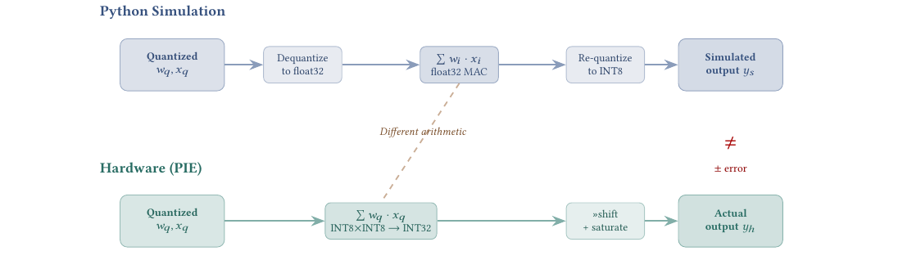
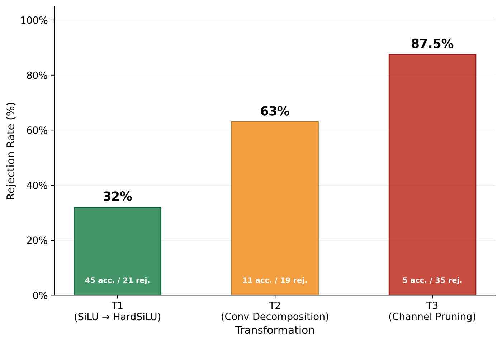
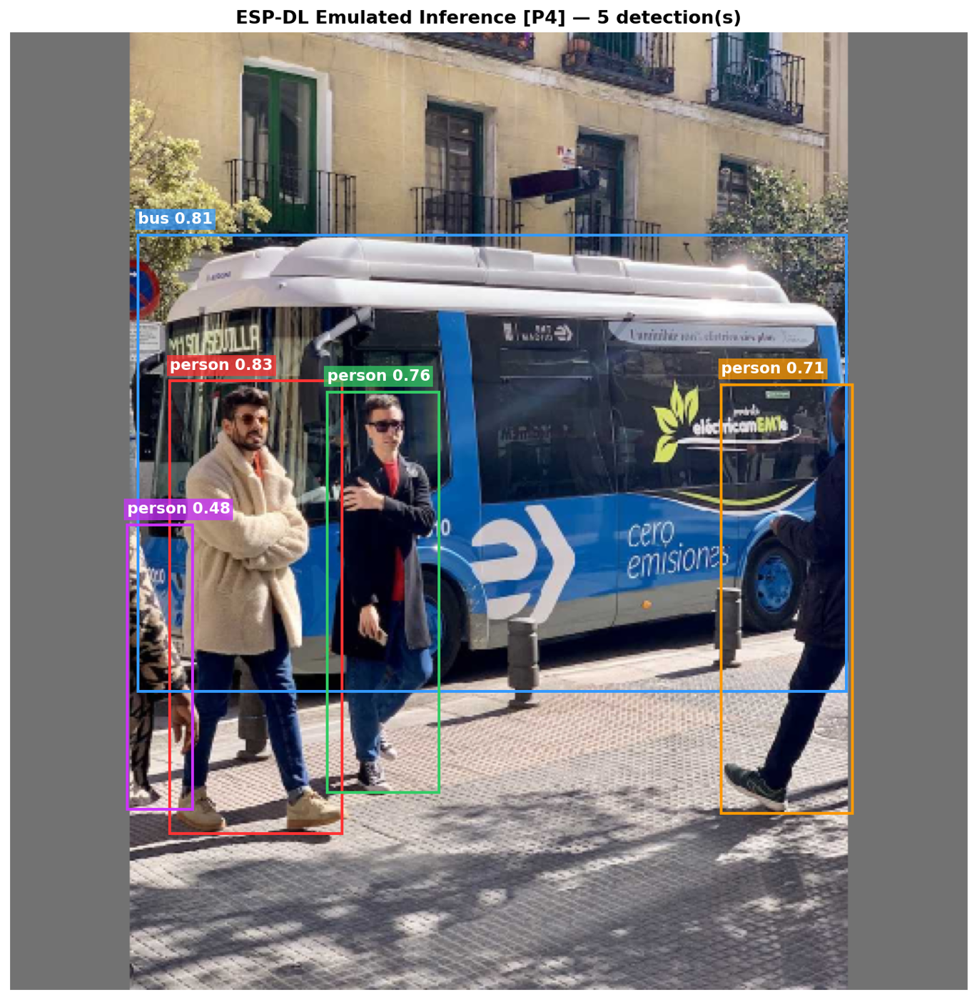

# From Simulation to Silicon: Fast and Exact YOLO26 Object Detection on Low-Cost Microcontrollers

### Bridging the simulation gap: multi-level optimization of YOLO26 for TinyML deployment on the ESP32-P4

[](conference/AIoT2026_acceptance_email.png)
[](conference/AIoT2026_acceptance_email.png)
[](https://github.com/espressif/esp-dl/pull/286)
[](https://github.com/espressif/esp-dl/pull/310)

**Billal Boumedine**¹ · **Amina Belkacem**¹ · **Naima Boukhiar**²\*
¹ Faculty of Computer Science, USTHB, Algiers, Algeria · ² Higher School of Computer Science (ESI), Algiers, Algeria
\* Corresponding author

Accepted for presentation at **AIoT '26, the 3rd International Workshop on the Integration of
Distributed Machine Learning and the Internet of Things**, November 26, 2026, Tokyo, Japan (ACM).

| 📄 [Paper](paper/From_Simulation_to_Silicon_YOLO26_ESP32-P4_AIoT2026.pdf) | ✉️ [Acceptance](conference/AIoT2026_acceptance_email.png) | 💻 [Code: esp-dl PR #310](https://github.com/espressif/esp-dl/pull/310) |
|---|---|---|

---

## Abstract

Object detection is increasingly expected to run directly on ultra-low-cost microcontrollers
rather than in the cloud. Yet no deployment of the NMS-free **YOLO26** detector had been shown
on the **$5, GPU-free ESP32-P4**, and its depthwise, quantization-sensitive detection head made
naive post-training quantization fail outright.

We show that closing this gap needs **multi-level co-design**: optimizing the model's
computation graph *together with* the hardware kernels that run it. We deployed YOLO26n
(2.4 M parameters) on the ESP32-P4 using mixed-precision INT16/INT8 quantization, validated by
a custom **bit-exact emulator**. A **Neural Morphing Engine** then rewrites the graph into
hardware-friendly operators, paired with **four custom PIE SIMD kernels**.

Inference dropped from **2,072 ms to 1,088 ms** (1.90× faster) at **0.361 mAP50-95**, only 3.7%
below the FP32 reference. That is **2.54× faster than the official YOLOv11n deployment** at
comparable accuracy. On-device output matched the Python simulation **bit for bit** (0 of
451,584 values in error), while bypassing the emulator produced divergence in 88% of values.

**Keywords:** TinyML, edge inference, object detection, YOLO26, RISC-V, microcontrollers,
quantization, hardware-software co-design, SIMD kernels, IoT

## Key results

| | Latency | mAP50-95 | Speedup |
|---|---|---|---|
| FP32 reference | — | 0.375 | — |
| Official YOLOv11n on ESP32-P4 | — | 0.360 | 1.00× |
| **Mixed-precision baseline** (merged in esp-dl #286) | 2,072 ms | 0.365 | 1.33× |
| **Co-designed model + kernels** (esp-dl #310) | **1,088 ms** | **0.361** | **2.54×** |

- **First documented deployment** of the NMS-free YOLO26n on the ESP32-P4.
- **100% bit-exact parity** between the Python digital twin and the RISC-V firmware. This makes
  it possible to evaluate the full 5,000-image COCO val2017 set on a PC in seconds instead of
  about 91 minutes on the device.
- **The ESP32-P4 is memory-bound, not compute-bound.** The largest gain came from keeping data
  in cache, not from cutting arithmetic: one layer went from 305 ms to 23 ms (13.3×).

## Platform

| | |
|---|---|
| Microcontroller | ESP32-P4, dual-core RISC-V at 400 MHz, about $5 |
| Accelerator | PIE SIMD coprocessor, 16 INT8 MACs per cycle; no GPU, no NPU |
| Memory | 768 KB SRAM, 32 MB PSRAM |
| Model | YOLO26n (2.4 M parameters), NMS-free head with RegMax = 1 direct box regression |
| Input / data | 512 × 512, COCO val2017 |

## Method

### 1. Mixed-precision quantization and the simulation gap

Uniform INT8 quantization destroyed box regression, because the RegMax = 1 head carries each
box coordinate in a single value with nothing to absorb rounding error. INT16 convolutions with
INT8 activations created a bottleneck at the Swish activation, and a naive INT16 Swish cost
+660 ms per layer. The fix was an **INT16 lookup-table approximation** of Swish/Sigmoid.

Standard toolchains simulate this in floating point, but the chip computes in fixed point with
truncation toward zero, so the two disagree. We built **`esp_ppq_lut`**, an extension of
Espressif's ESP-PPQ that reproduces the chip's integer arithmetic bit for bit.

<p align="center">
  
  <br><em>Fig. 1. The simulation gap: the toolchain computes in float32 (top), the ESP32-P4 PIE in fixed point with truncation (bottom). On the INT16 LUT primitive, the two disagree on 88% of output values.</em>
</p>

### 2. Neural Morphing Engine (model level)

The engine rewrites the graph block by block: pick an operation, splice in a replacement, train
it against the frozen original model on 512 unlabelled images (knowledge distillation), and keep
it only if it passes a quality gate (cosine similarity ≥ 0.99, output magnitude within ±1.5%).
Otherwise it rolls back automatically.

| Transformation | Accepted | Accuracy cost | Deployed |
|---|---|---|---|
| T1: SiLU → HardSiLU8 | 45 / 66 (68%) | −0.005 mAP | ✅ |
| T2: 3×3 conv → depthwise + pointwise | 11 / 30 (37%) | — | evaluated only |
| T3: channel pruning | 5 / 40 (13%) | −0.025 mAP | evaluated only |

<p align="center">
  
  <br><em>Fig. 2. The more invasive the transformation, the more often the quality gate rejects it.</em>
</p>

### 3. Hardware kernel co-design (hardware level)

Four custom PIE SIMD kernels, applied one at a time:

| Kernel stage | Latency (ms) | Reduction |
|---|---|---|
| Mixed-precision baseline | 2,072 | — |
| TransposePIE | 1,769 | 14.6% |
| NN-LUTINT16 | 1,613 | 22.2% |
| HardSiluPie8 | 1,482 | 28.5% |
| TiledConvBlock (spatial tiling) | 1,156 | 44.2% |
| TiledConvBlock (1×1 conv) | 1,103 | 46.8% |
| Vector hoisting | **1,088** | **47.5%** |

TiledConvBlock is the largest single contributor (326 ms). It fuses convolution and activation
into tiles that stay in cache instead of going back and forth to the slow PSRAM. A roofline
analysis supports this: PIE peak compute is 6.4 GMAC/s and PSRAM bandwidth is 184 MB/s, so any
kernel below about 35 MACs per byte is limited by memory, not compute.

### 4. Bit-exact validation

<p align="center">
  
  <br><em>Fig. 3. On-device inference: all 5 detections (class, confidence, box) are identical to the Python digital twin.</em>
</p>

- **Test 0:** input preprocessing matches between Python and firmware.
- **Test 1:** all 451,584 output values of the full model match the device exactly.
- **Test 2 (control):** without the emulator, 88% of values diverge, so Test 1 is not a trivial pass.

## Limitations and next steps

The paper states these openly:

- Scope is one detector (YOLO26n), one dataset (COCO val2017) and one chip (ESP32-P4).
- Energy was not measured directly. A rough estimate from the supply requirements is
  1.4–1.5 J per inference; a current-sense measurement is the next step.
- No comparison yet against an established quantization method such as AdaRound.
- Next: port to the ESP32-S3 (same PIE instruction set), sweep the quality-gate thresholds and
  distillation budget, and build an MLIR backend to generalize to other model families.

## Repository contents

```
Multi-level-Optimization-of-YOLO-for-TinyML-Deployment-on-ESP32-P4/
├── paper/        accepted paper (PDF) and first-page preview
├── conference/   AIoT 2026 acceptance email
└── figures/      simulation gap, morphing rejection rates, on-device detections
```

## Code

The implementation lives in Espressif's official **esp-dl** SDK:

- **[espressif/esp-dl PR #310](https://github.com/espressif/esp-dl/pull/310)**: the four PIE SIMD kernels, the Neural Morphing Engine, the quantization pipeline and the bit-exact validation (1,088 ms, 0.361 mAP). Under review; the maintainers singled out TransposePIE, TiledConvBlock and NN-LUT as "very impressive".
- **[espressif/esp-dl PR #286](https://github.com/espressif/esp-dl/pull/286)**: the mixed-precision YOLO26n baseline with the bit-exact LUT emulator (2,072 ms, 0.365 mAP). Merged after review by Espressif engineers.

## Related repositories

- [Towards_RealTime_Precision_Agriculture](https://github.com/naimabouk/Towards_RealTime_Precision_Agriculture): task-aware multi-modal decision framework (IEEE ISAIA 2026)
- [Smart_Home_Safety_ML](https://github.com/naimabouk/Smart_Home_Safety_ML): low-cost IoT home safety with ML (ICDET 2026)
- [hurudza-iot-telemetry](https://github.com/naimabouk/hurudza-iot-telemetry): ESP32 multi-sensor field node

## Citation

```bibtex
@inproceedings{boumedine2026simulation,
  title     = {From Simulation to Silicon: Fast and Exact YOLO26 Object Detection on Low-Cost Microcontrollers},
  author    = {Boumedine, Billal and Belkacem, Amina and Boukhiar, Naima},
  booktitle = {Proceedings of the 3rd International Workshop on the Integration of Distributed
               Machine Learning and the Internet of Things (AIoT '26)},
  address   = {Tokyo, Japan},
  year      = {2026},
  publisher = {ACM},
  note      = {Accepted, to appear}
}
```

## Contact

Naima Boukhiar (corresponding author), High School of Computer Science ESI · naima.boukhiar@univ-alger.dz
